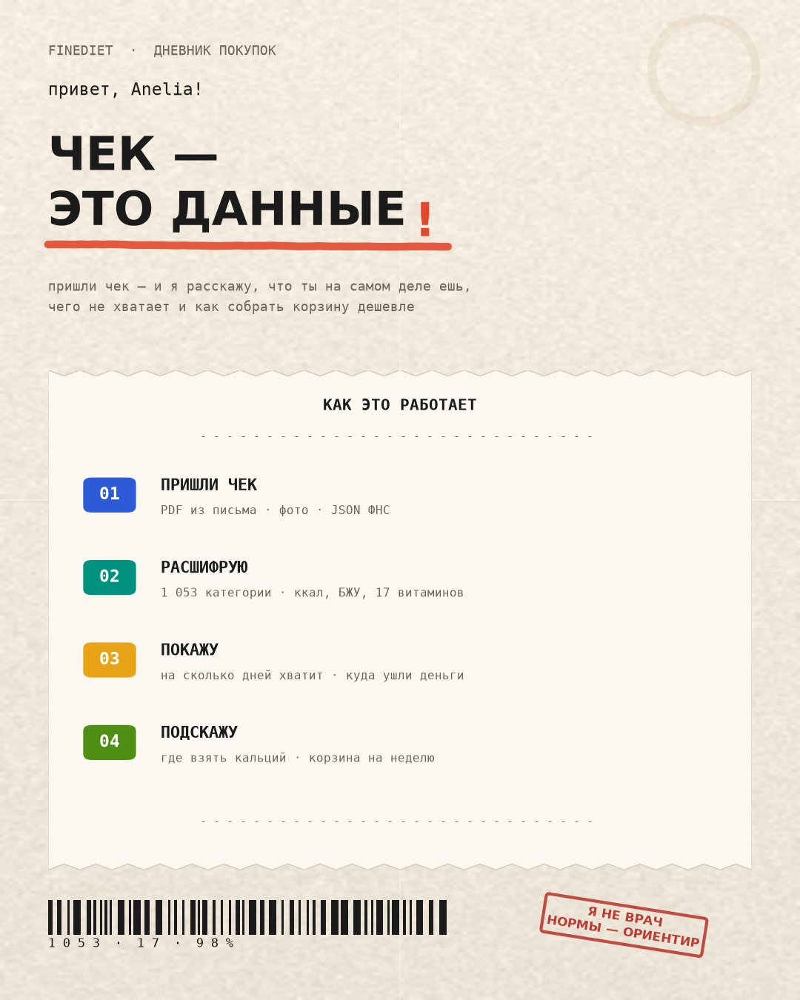
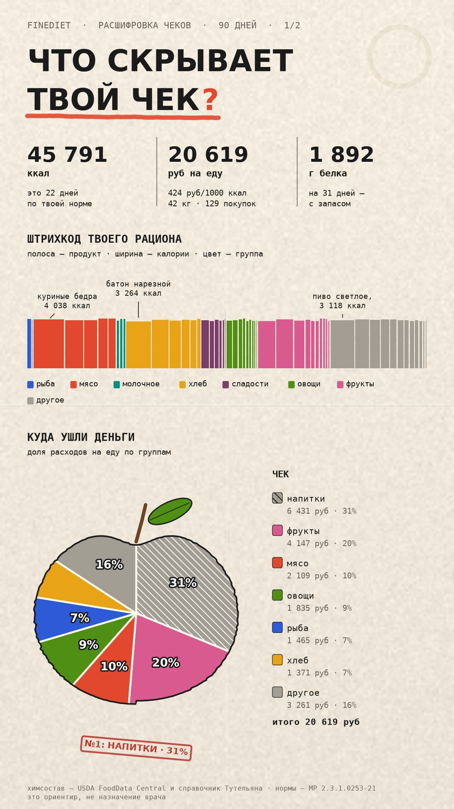
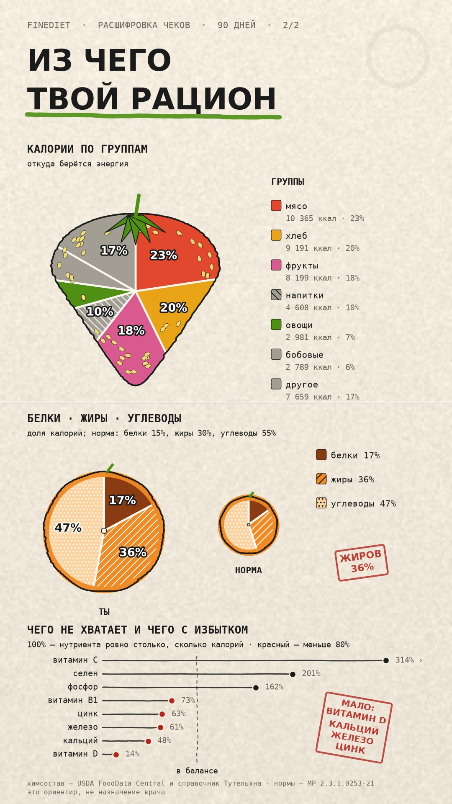
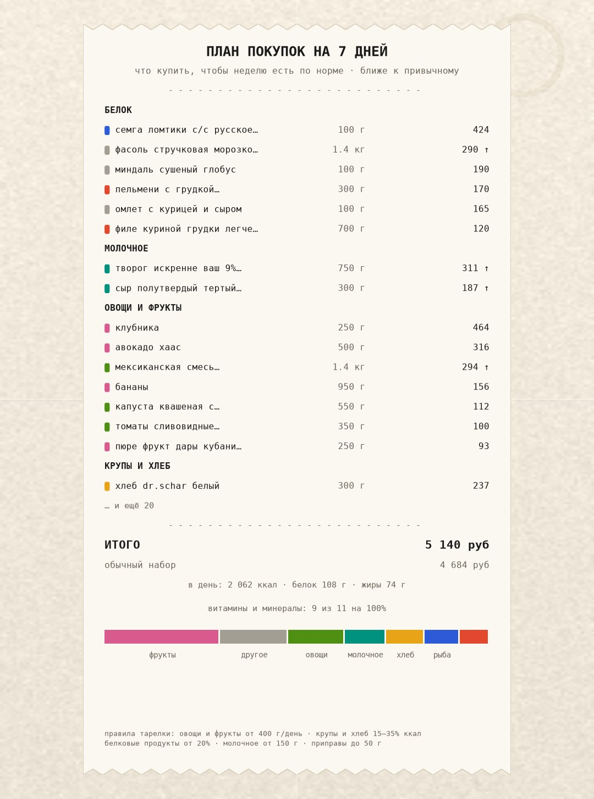
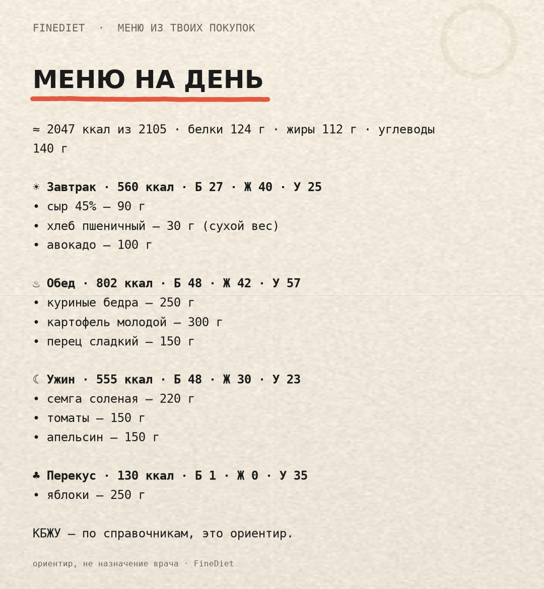
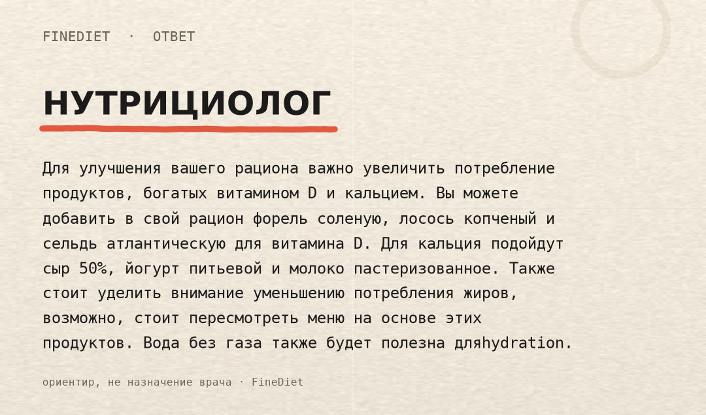
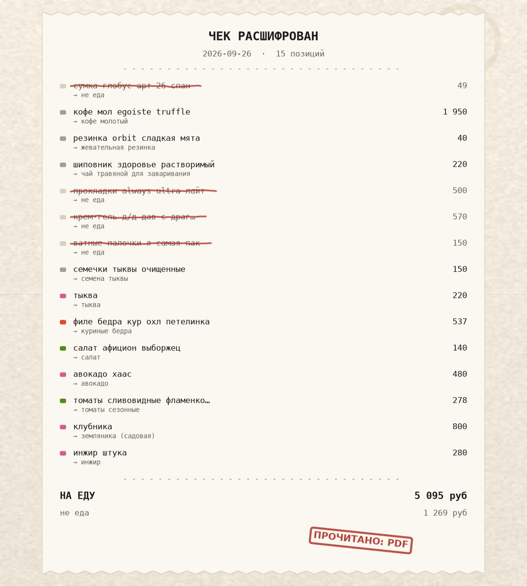
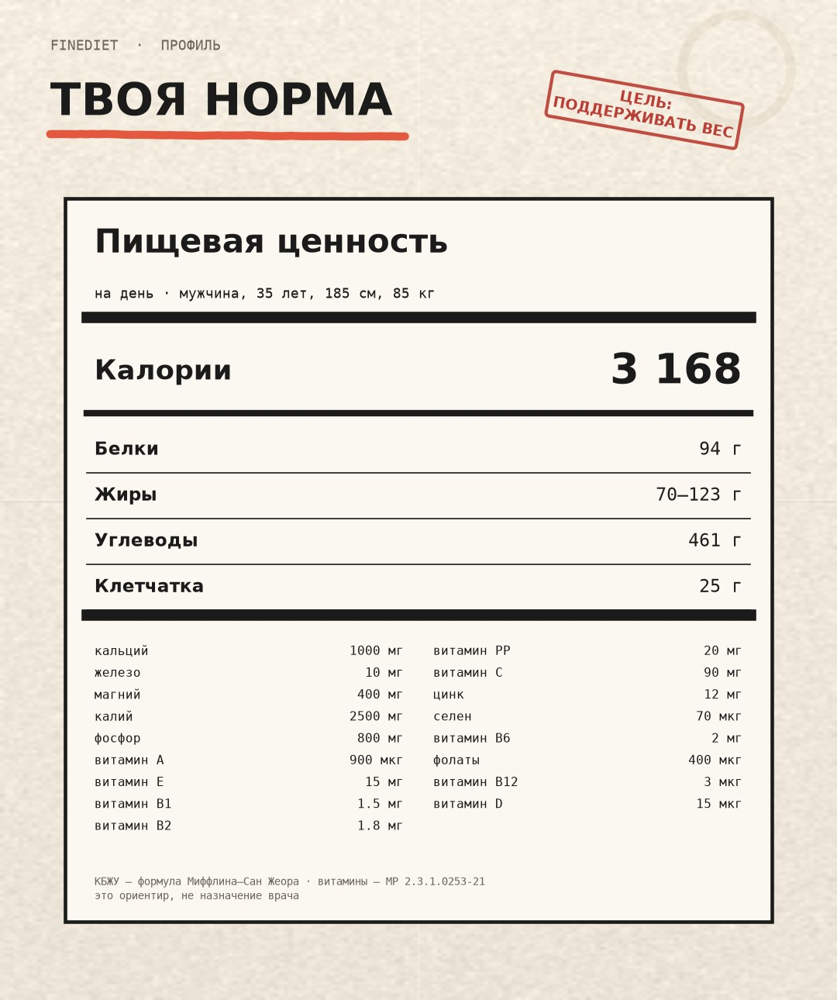
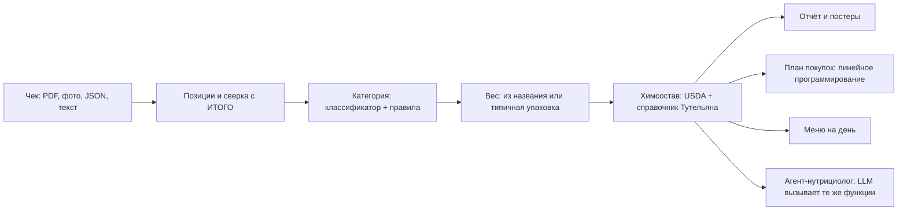

# FineDiet — что скрывает твой чек

**Telegram-бот, который превращает кассовые чеки в данные о питании:** что ты на самом деле ешь, чего не хватает, куда уходят деньги и что купить на неделю, чтобы есть по норме и не переплачивать.

Чек всё равно приходит после каждой покупки, вести дневник питания вручную не нужно. Это главная идея проекта.

**Открытые данные проекта на Kaggle:** [чеки: 82 тыс. позиций, 1053 категории](https://www.kaggle.com/datasets/bizziberri/purchase-data) · [категории → нутриенты USDA](https://www.kaggle.com/datasets/bizziberri/russian-grocery-categories-to-usda-nutrients) · [ноутбук quick start](https://www.kaggle.com/code/bizziberri/russian-grocery-usda-nutrients-quick-start)

## Benchmark | Бенчмарк

**[Russian grocery & nutrition (pilot)](https://www.kaggle.com/benchmarks/bizziberri/russian-grocery-and-nutrition-pilot)** — Kaggle benchmark built on the FineDiet dataset. It tests whether LLMs can do the bot's core job: match a Russian product name to a USDA FoodData Central record (or say "none" / "ask"), and compute nutrients for portions like "0,4 кг" or "3 шт. по 55 г".

— бенчмарк на Kaggle, построенный на датасете FineDiet. Он проверяет, справляются ли языковые модели с главной задачей бота: сопоставить русское название продукта с записью USDA FoodData Central (или ответить «нет подходящей» / «нужно уточнить») и посчитать нутриенты для порций вроде «0,4 кг» или «3 шт. по 55 г».

| | |
|:---:|:---:|
| <br>**Приветствие:** как это работает | <br>**«Мой рацион» 1/2:** цифры, штрихкод рациона, деньги |
| <br>**«Мой рацион» 2/2:** калории по группам, БЖУ, чего не хватает | <br>**План покупок на неделю:** под нормы и бюджет |
| <br>**Меню на день** из своих покупок | <br>**Нутрициолог:** ответы по цифрам из чеков |
| <br>**Чек расшифрован:** категории, не еда зачёркнута | <br>**Профиль:** личная норма на день |

## Что умеет
- **Читает чек в любом виде:** PDF из письма магазина, фото, JSON из «Проверки чеков» ФНС, Word, Excel, текст. Сумма позиций сверяется с «ИТОГО».
- **Раскладывает покупки по 1 053 категориям** продуктов (классификатор TF-IDF + LinearSVM, accuracy 0.912) с правилами-страховкой: корма для животных, «миндаль — это орехи, а не печенье».
- **Считает калории, БЖУ, клетчатку и 17 витаминов и минералов** и показывает, на сколько дней их хватит при твоей норме.
- **Подсказывает, где взять** то, чего мало, и отмечает продукты, которые ты ещё не покупаешь.
- **Собирает план покупок на неделю** из твоих же продуктов по твоим ценам: линейное программирование, правила здоровой тарелки, режимы «ближе к привычному» и «самый дешёвый».
- **Составляет меню на день** (завтрак, обед, ужин) с граммами и КБЖУ под твою норму.
- **Отвечает на вопросы через агента-нутрициолога:** LLM с инструментами, все числа считает код.

## Как это работает


**Ключевые решения:**
- **Числа считает код, модель только объясняет.** Поэтому агент не выдумывает калории, а без LLM все кнопки продолжают работать.
- **Химсостав из двух источников.** USDA FoodData Central (общественное достояние) — основной слой, справочник Тутельяна закрывает русские продукты: творог, кефир, сырки, супы. Химсостав известен для **98% покупок** датасета.
- **Американское обогащение не переносится.** В США мука, хлеб и молоко обогащены железом, витаминами группы B и D, российские продукты обычно нет. Где возможно, берётся необогащённый вариант, иначе значение из справочника или «неизвестно».
- **«Неизвестно» не равно нулю.** Цинк, селен, B12 и витамин D бот оценивает, только если состав известен для 60% купленного веса и больше.
- **Витамины в плане покупок — мягкое ограничение.** Ради витамина бот не купит килограмм сёмги, а честно напишет «витамин E 67%».

## Где можно развить
Проект собран как основа: каждый блок можно углубить под конкретный запрос.

| Направление | Что сделать |
|---|---|
| **Рецепты** | База проверенных рецептов и правила сочетаний вместо шаблонов. Сейчас маленькая локальная модель пишет рецепты ненадёжно («отвари авокадо»), поэтому по умолчанию работают шаблоны. |
| **Модель для нутрициолога** | Облачная LLM (Claude, OpenAI, OpenRouter) подключается тремя строками в `.env`: ответы за секунды, сам выбирает инструменты и пишет рецепты. Локальная Ollama остаётся приватным вариантом. |
| **Исследование** | Сравнение USDA и справочника Тутельяна на реальных чеках: примерно у сотни категорий калории расходятся в 1,5 раза и больше (свинина, птица с кожей и без, рецептуры блюд). Это материал для отдельной статьи или ноутбука на Kaggle. |
| **Точность** | Дообучение классификатора на ошибках, трансформер вместо TF-IDF; химсостав по конкретным маркам, а не по категориям. |
| **Продукт** | Цели «похудеть или набрать» с прогнозом, напоминания, семейный бюджет, экспорт плана покупок в список. |
| **Медицина** | Нормы для детей, беременности, спортсменов — только вместе со специалистом. |

## Запуск
```powershell
pip install -r requirements.txt
copy .env.example .env            # вписать токен от @BotFather

# 1. классификатор (один раз, 10–20 мин): receipt_items.csv с Kaggle
python train_model.py --data receipt_items.csv

# 2. химсостав: USDA (архивы FoodData Central, распаковывать не нужно) + справочник
python import_usda.py --dir "путь\к\архивам\usda" --data receipt_items.csv
python import_nutrients.py "путь\к\nutrition.xlsx" --data receipt_items.csv
python make_pack_weights.py "путь\к\df_cleaned_filtered.xlsx"

# 3. (необязательно) нутрициолог: Ollama (ollama pull qwen2.5:3b) или облачная модель, строки LLM_ в .env
# 4. (необязательно) фото чеков: Tesseract (язык Russian) или LLM_VISION_MODEL

python bot.py
```

## Структура
| файл | что внутри |
|---|---|
| `bot.py` | Telegram-бот: меню, профиль, приём чеков, отчёты, план покупок, меню на день |
| `readers.py` | чек в любом формате → текст → позиции, сверка с «ИТОГО» |
| `receipt.py`, `classify.py`, `category_rules.csv` | вес из названия, классификатор с правилами-страховкой |
| `nutrition.py` | химсостав, нормы, анализ покупок, «где взять» |
| `optimizer.py` | план покупок (два режима) и замены |
| `menu.py` | меню на день и рецепты по шаблону |
| `agent.py` | нутрициолог: промпт, 7 инструментов, быстрый путь для слабых компьютеров |
| `charts.py` | постеры и карточки: бумага, штрихкод рациона, фруктовые диаграммы |
| `storage.py` | профили и покупки в SQLite |
| `model.py`, `train_model.py` | классификатор (accuracy 0.912, macro F1 0.688 на отложенных 20%) |
| `import_usda.py`, `usda_map.csv` | сопоставление категорий с USDA FoodData Central → `nutrients_usda.csv` |
| `import_nutrients.py`, `nutrients_manual.csv` | справочник из Excel и итоговая таблица `nutrients.csv` |

## Данные и лицензии
- Чеки: [Russian Grocery Receipts: 82k Items, 1053 Foods](https://www.kaggle.com/datasets/bizziberri/purchase-data) · сравнение моделей: [ноутбук на Kaggle](https://www.kaggle.com/code/bizziberri/russian-receipts-food-classification-baselines).
- Химсостав: U.S. Department of Agriculture, Agricultural Research Service. FoodData Central, fdc.nal.usda.gov (CC0). Сопоставление опубликовано отдельным датасетом: [Russian Grocery Categories to USDA Nutrients](https://www.kaggle.com/datasets/bizziberri/russian-grocery-categories-to-usda-nutrients) (771 категория, 24 нутриента, CC BY 4.0) · пример использования: [ноутбук quick start](https://www.kaggle.com/code/bizziberri/russian-grocery-usda-nutrients-quick-start).
- Справочник: Тутельян В. А. и др. «Химический состав и калорийность российских продуктов питания». М.: ДеЛи плюс, 2012. Защищён авторским правом, поэтому значения из него в репозиторий не входят, только коды категорий.
- Нормы: КБЖУ по формуле Миффлина–Сан Жеора, витамины и минералы по МР 2.3.1.0253-21. Это ориентир, а не медицинское назначение.

Лицензия кода — в файле [LICENSE](LICENSE).

В git **не попадают**: `.env` (токены и ключи), `model.joblib`, `nutrients.csv`, Excel справочника и `finediet.db` (покупки пользователей).

## Ограничения
- Классификатор иногда ошибается по смыслу; правила страхуют известные случаи.
- Фото с бледной печатью теряют строки количества, PDF надёжнее.
- Фастфуд и часть готовой еды остаются без химсостава.
- Нормы рассчитаны на взрослых 18–59 лет без заболеваний.
